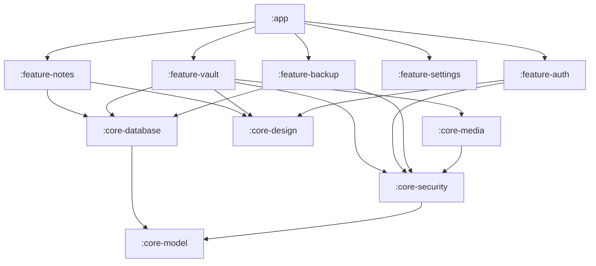

# System Architecture Specification — Vault

## 1. Architectural Philosophy & Principles

The architecture of **Vault** adheres to **Clean Architecture** and **Modern Android Architecture (MVVM)**, enforcing strict separation of concerns, unidirectional data flow (UDF), and zero-trust cryptographic boundaries.

```
+-----------------------------------------------------------------------------------+
|                                PRESENTATION LAYER                                 |
|   Jetpack Compose UI  |  ViewModels (StateFlow / UiState)  |  Navigation Graphs   |
+-----------------------------------------------------------------------------------+
                                         |
                                         v
+-----------------------------------------------------------------------------------+
|                                   DOMAIN LAYER                                    |
|   Pure Kotlin Business Logic  |  Use Cases / Interactors  |  Domain Models        |
+-----------------------------------------------------------------------------------+
                                         |
         +-------------------------------+-------------------------------+
         |                               |                               |
         v                               v                               v
+------------------+           +-------------------+           +--------------------+
|    DATA LAYER    |           |  SECURITY LAYER   |           |    MEDIA LAYER     |
| Room Databases   |           | Android Keystore  |           | Encrypted ExoPlayer|
| Repositories     |           | AES-256-GCM       |           | In-Memory Coil     |
| DataStore Preferences        | PBKDF2 / Argon2   |           | PhotoPicker / SAF  |
+------------------+           +-------------------+           +--------------------+
```

---

## 2. Layer Definitions & Boundaries

### 2.1 Presentation Layer
- **Components:** Jetpack Compose Composables, `ViewModel` classes, `UiState` data classes, `UiEvent` sealed interfaces.
- **Rules:**
  - ViewModels emit immutable `StateFlow<UiState>` collected with `collectAsStateWithLifecycle()`.
  - Zero cryptographic computations or disk I/O in Composables or ViewModels.
  - ViewModels communicate exclusively with the Domain layer via Use Cases.

### 2.2 Domain Layer (Pure Kotlin)
- **Components:** Use Cases (`GetNotesUseCase`, `EncryptAndImportMediaUseCase`, `VerifyPinUseCase`, `UnlockVaultUseCase`), Domain Models, Repository Interfaces.
- **Rules:**
  - No Android framework dependencies (`android.*`) except lightweight utility interfaces.
  - Highly unit-testable without emulators or Robolectric.

### 2.3 Data Layer
- **Components:** Repository Implementations (`NotesRepositoryImpl`, `VaultRepositoryImpl`, `AuthRepositoryImpl`), Room DAOs, DataStore Preferences.
- **Rules:**
  - Room stores only metadata (paths, sizes, IVs, hashes, mime types); sensitive plaintext media and keys are never stored in Room.
  - Multi-database isolation: `notes.db` (public notes), `vault_primary.db` (primary vault), and `vault_decoy.db` (decoy vault).

### 2.4 Security Layer (`core-security`)
- **Components:** `KeystoreManager`, `AesGcmCipherService`, `KeyDerivationService`, `VaultSessionManager`, `MemoryScrubber`.
- **Rules:**
  - AES-256-GCM authenticated encryption with 128-bit authentication tag.
  - Unique 12-byte random nonce per file.
  - Hardware-backed Android Keystore key management (StrongBox / TEE).
  - Explicit zeroization (`Arrays.fill(..., 0)`) of in-memory keys and buffers upon session close.

### 2.5 Media Management Layer (`core-media` / `feature-media`)
- **Components:** `EncryptedFileDataSource` (ExoPlayer custom source), `EncryptedThumbnailFetcher` (Coil image loader), `MediaImportService`.
- **Rules:**
  - Zero decrypted files staged to disk.
  - Media streaming directly to memory decoders in 64 KB chunks.

---

## 3. Module Hierarchy & Dependency Graph



---

## 4. Concurrency & Coroutines Policy

- **Dispatchers Strategy:**
  - `Dispatchers.IO`: File encryption, Room database queries, chunked disk streaming.
  - `Dispatchers.Default`: Key derivation (PBKDF2), bitmap processing, checksum hashing.
  - `Dispatchers.Main.immediate`: UI state updates and navigation triggers.
- **Structured Concurrency:**
  - Every long-running import job runs within a managed `CoroutineScope` with a `SupervisorJob`.
  - Cancellations ensure immediate cleanup of partial `.tmp` files.

---

## 5. Dependency Injection Architecture (Hilt)

- Root Application annotated with `@HiltAndroidApp`.
- **Modules:**
  - `SecurityModule`: Provides `KeyStore`, `KeyDerivationService`, `AesGcmCipherService`, `VaultSessionManager`.
  - `DatabaseModule`: Provides `NotesDatabase`, `PrimaryVaultDatabaseFactory`, `DecoyVaultDatabaseFactory`.
  - `RepositoryModule`: Binds domain repository interfaces to concrete implementations (`@Binds @Singleton`).
  - `DispatchersModule`: Provides named coroutine dispatchers (`@IoDispatcher`, `@DefaultDispatcher`).

---

## 6. Error Handling Strategy

Vault implements a robust, functional error handling model:
```kotlin
sealed interface AppResult<out T> {
    data class Success<T>(val data: T) : AppResult<T>
    sealed interface Failure : AppResult<Nothing> {
        data class SecurityError(val reason: String) : Failure
        data class StorageError(val exception: Throwable) : Failure
        data class CorruptedDataError(val message: String) : Failure
        data class UserCancelled(val reason: String) : Failure
    }
}
```
All repository methods return `Flow<AppResult<T>>` or `suspend () -> AppResult<T>`.

---

## 7. Logging & Telemetry Policy

- **Debug Builds:** Timber `DebugTree` active; logs file operations with sanitized file IDs (UUIDs only, no file names, no key bytes).
- **Release Builds:** ProGuard/R8 completely strips `android.util.Log` and `timber.log.Timber` calls.
- **Zero Third-Party Trackers:** No Firebase Crashlytics, Google Analytics, or external network SDKs. Vault is 100% offline.

---

## 8. Testing Strategy

1. **Unit Tests (JUnit 5 + MockK + Turbine):**
   - 100% coverage on cryptographic primitives (IV uniqueness, GCM tag verification, PBKDF2 derivation).
   - 100% coverage on Use Cases and ViewModels with `TestDispatcher`.
2. **Integration Tests (Robolectric + Room in-memory DB):**
   - Verification of database migrations and multi-database isolation.
3. **Instrumentation Tests (Espresso + Compose Test Rule):**
   - UI tests for notes CRUD, secret gesture detection, stealth keypad interactions.

