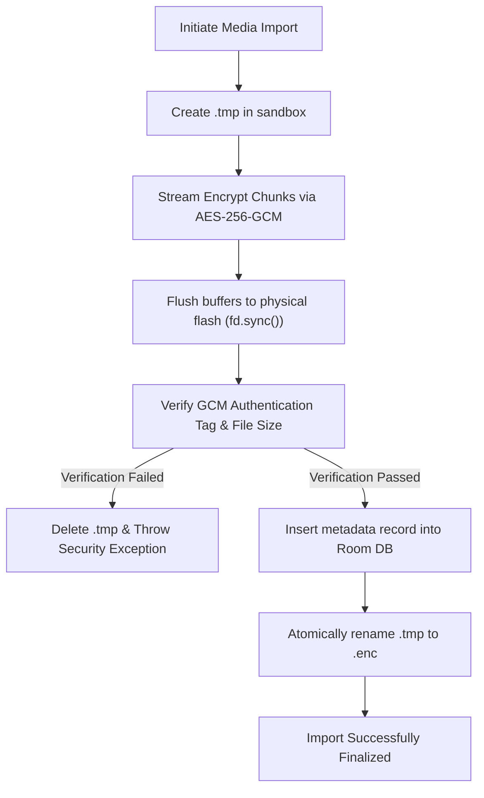

# Encryption & Cryptographic Design Specification — Vault

## 1. Cryptographic Primitive Standards

| Parameter | Specification | Standard / Reference |
| :--- | :--- | :--- |
| **Cipher Algorithm** | AES-256 in Galois/Counter Mode (`AES/GCM/NoPadding`) | NIST SP 800-38D |
| **Key Length** | 256 bits (32 bytes) | FIPS 197 |
| **Authentication Tag** | 128 bits (16 bytes) | RFC 5116 |
| **Initialization Vector (IV)** | 96 bits (12 bytes) | NIST Recommended |
| **PRNG Provider** | `java.security.SecureRandom` (Native Linux `/dev/urandom`) | NIST SP 800-90A |
| **Key Derivation (PIN)** | `PBKDF2WithHmacSHA256` (100,000 iterations) | RFC 2898 / RFC 8018 |
| **Backup Key Derivation** | `Argon2id` or `PBKDF2WithHmacSHA256` (150,000 iterations) | Password Hashing Competition |

---

## 2. Nonce (IV) Management & Collision Prevention

### 2.1 The GCM Nonce Reuse Catastrophe
In Galois/Counter Mode (GCM), reusing an Initialization Vector (IV) with the same encryption key completely breaks the authenticity of the cipher (exposing the internal authentication key $H = E_K(0)$) and compromises confidentiality by XORing plaintexts ($C_1 \oplus C_2 = P_1 \oplus P_2$).

### 2.2 Vault Nonce Enforcement Protocol
1. **Fresh IV per Operation:** Every single encryption operation (file, thumbnail, backup block) generates a new 12-byte IV using `SecureRandom.nextBytes(iv)`.
2. **Deterministic Uniqueness:** The probability of a collision with a 96-bit cryptographically secure random nonce is bounded by the birthday paradox: with $2^{32}$ files, collision probability is $< 2^{-33}$ (negligible).
3. **Storage:** The 12-byte IV is prepended to the ciphertext file or recorded in the database record `iv_base64`. It is not secret; only its uniqueness is critical.

---

## 3. Chunked Streaming Protocol for Large Media

Directly passing large video files (1 GB–10 GB) into `Cipher.doFinal()` causes immediate Android Out-Of-Memory (`OutOfMemoryError`) crashes. Vault implements a chunked streaming cipher pipeline:

```
[ Plaintext Input Stream ]
           |
           | Read 64 KB Chunk
           v
+----------------------+
| Cipher.update()      | ---> [ Ciphertext Output Stream ]
+----------------------+
           |
           | (Repeat for all chunks)
           v
+----------------------+
| Cipher.doFinal()     | ---> [ Append 16-byte GCM Auth Tag ]
+----------------------+
```

### 3.1 Streaming Encryption Implementation Contract
```kotlin
fun encryptStream(
    inputStream: InputStream,
    outputFile: File,
    secretKey: SecretKey,
    onProgress: (bytesWritten: Long) -> Unit
): EncryptionResult {
    val iv = ByteArray(12)
    SecureRandom().nextBytes(iv)
    
    val cipher = Cipher.getInstance("AES/GCM/NoPadding")
    val gcmSpec = GCMParameterSpec(128, iv)
    cipher.init(Cipher.ENCRYPT_MODE, secretKey, gcmSpec)
    
    val tempFile = File(outputFile.parentFile, "${outputFile.name}.tmp")
    var totalBytesWritten = 0L
    
    FileOutputStream(tempFile).use { fos ->
        // Write 12-byte IV as file header
        fos.write(iv)
        
        val buffer = ByteArray(64 * 1024) // 64 KB buffer
        var bytesRead: Int
        
        while (inputStream.read(buffer).also { bytesRead = it } != -1) {
            val ciphertextChunk = cipher.update(buffer, 0, bytesRead)
            if (ciphertextChunk != null && ciphertextChunk.isNotEmpty()) {
                fos.write(ciphertextChunk)
                totalBytesWritten += ciphertextChunk.size
                onProgress(totalBytesWritten)
            }
        }
        
        val finalBlock = cipher.doFinal()
        fos.write(finalBlock)
        fos.fd.sync() // Ensure physical flush to flash media
    }
    
    // Atomic rename to target .enc filename
    if (!tempFile.renameTo(outputFile)) {
        throw IOException("Failed to atomically commit encrypted file")
    }
    
    return EncryptionResult(
        outputFile = outputFile,
        iv = iv,
        ciphertextSize = outputFile.length()
    )
}
```

---

## 4. In-Memory Video Seeking & ExoPlayer Custom DataSource

For video seeking without decrypting the entire file from byte 0:
- Standard AES-GCM uses an internal 32-bit counter starting at $IV \parallel 00000002_{32}$ to encrypt plaintext via AES-CTR.
- Our custom `EncryptedFileDataSource` maps requested byte ranges `[offset, offset + length)`:
  1. Computes the 16-byte block boundary index: $\text{blockIndex} = \lfloor \text{offset} / 16 \rfloor$.
  2. Initializes a targeted AES-CTR cipher instance matching the GCM key and counter state at $\text{blockIndex}$.
  3. Decrypts only the requested frame slice directly into ExoPlayer's playback memory buffer.
  4. Never creates temporary decrypted chunks on flash storage.

---

## 5. Atomic Commit & Crash Safety Protocol



If the device battery dies, the app is killed by the OS, or an exception occurs at any point before Step 6, no incomplete or unauthenticated `.enc` file will ever exist, and the orphaned `.tmp` file is purged on the next application startup.

