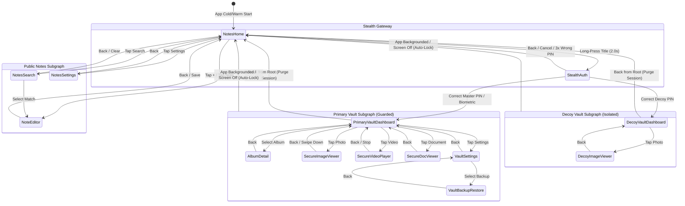

# Navigation Flow & Route Architecture — Vault

This document defines the Jetpack Navigation Compose graph structure, route constants, argument contracts, backstack hygiene, and session termination transitions across the application.

---

## 1. High-Level Navigation Topology

The navigation graph is split into two distinct subgraphs:
1. **Public Notes Graph (`notes_graph`):** Unrestricted, standard backstack behavior.
2. **Hidden Vault Graph (`vault_graph`):** Guarded by the authentication lifecycle, protected with `FLAG_SECURE`, and destroyed upon session termination or backgrounding.



---

## 2. Route Definitions & Contracts

### 2.1 Public Notes Routes
| Route Pattern | Arguments | Description |
| :--- | :--- | :--- |
| `notes_home` | None | Default landing screen displaying notes grid. |
| `note_editor/{noteId}` | `noteId: Long` (`-1L` for new note) | Note creation and editing surface. |
| `notes_search` | None | Full-text note search screen. |
| `notes_settings` | None | Public preferences (theme, note layout). |

### 2.2 Stealth & Authentication Routes
| Route Pattern | Arguments | Description |
| :--- | :--- | :--- |
| `stealth_auth` | None | Stealth PIN pad. Applies `FLAG_SECURE`. |
| `vault_setup` | None | First-run setup wizard for Master PIN & Decoy PIN. |

### 2.3 Primary Vault Routes (Session-Gated)
| Route Pattern | Arguments | Description |
| :--- | :--- | :--- |
| `vault_dashboard` | None | Vault media dashboard with categorized tabs. |
| `vault_album/{albumId}` | `albumId: Long` | Album contents view. |
| `secure_image_viewer/{fileId}` | `fileId: String` (UUID) | In-memory pinch-to-zoom image viewer. |
| `secure_video_player/{fileId}` | `fileId: String` (UUID) | ExoPlayer streaming video viewer. |
| `secure_doc_viewer/{fileId}` | `fileId: String` (UUID) | In-memory document & PDF viewer. |
| `vault_settings` | None | Vault security & auto-lock preferences. |
| `vault_backup_restore` | None | Encrypted export and restore management. |

### 2.4 Decoy Vault Routes (Session-Gated)
| Route Pattern | Arguments | Description |
| :--- | :--- | :--- |
| `decoy_dashboard` | None | Decoy media dashboard (isolated database). |
| `decoy_image_viewer/{fileId}` | `fileId: String` | Viewer for decoy images. |

---

## 3. Backstack Hygiene & Session Purge Rules

### Rule 1: Exiting Stealth Keypad
- When the user presses the system Back button or taps cancel on `stealth_auth`, the NavController executes:
  ```kotlin
  navController.popBackStack(route = "notes_home", inclusive = false)
  ```
- This leaves the user on `notes_home` with no trace of the keypad.

### Rule 2: Unlocking into Vault (Stack Replacement)
- When authentication succeeds (Master PIN or Decoy PIN):
  ```kotlin
  navController.navigate("vault_dashboard") {
      popUpTo("notes_home") {
          saveState = false
      }
      launchSingleTop = true
  }
  ```
- This prevents pressing the system Back button from accidentally returning to the `stealth_auth` screen.

### Rule 3: Exiting Vault to Public Notes
- When the user presses Back from `vault_dashboard`:
  1. The `VaultSessionManager` purges in-memory keys and closes database handles.
  2. The window removes `FLAG_SECURE` (if configured to allow screenshots in notes).
  3. Navigation executes:
     ```kotlin
     navController.navigate("notes_home") {
         popUpTo(0) { inclusive = true }
     }
     ```

### Rule 4: Auto-Lock Reset on App Lifecycle Events
- When `Activity.onStop()` or `ACTION_SCREEN_OFF` fires while any vault route is active:
  1. `VaultSessionManager.lock()` is immediately called.
  2. Memory buffers and decryption keys are cleared.
  3. The `NavHost` state is immediately overwritten to `notes_home`.
  4. When the user re-opens the app from the Android Launcher or Recent Apps, the app renders `notes_home` from a fresh, locked state.

