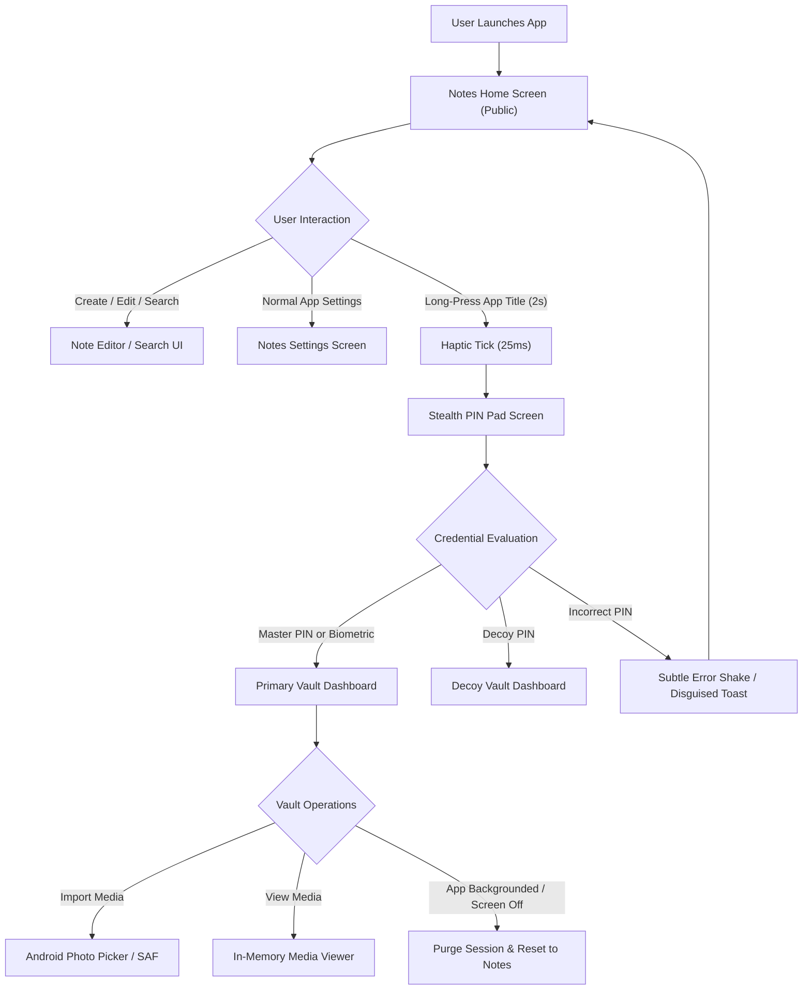
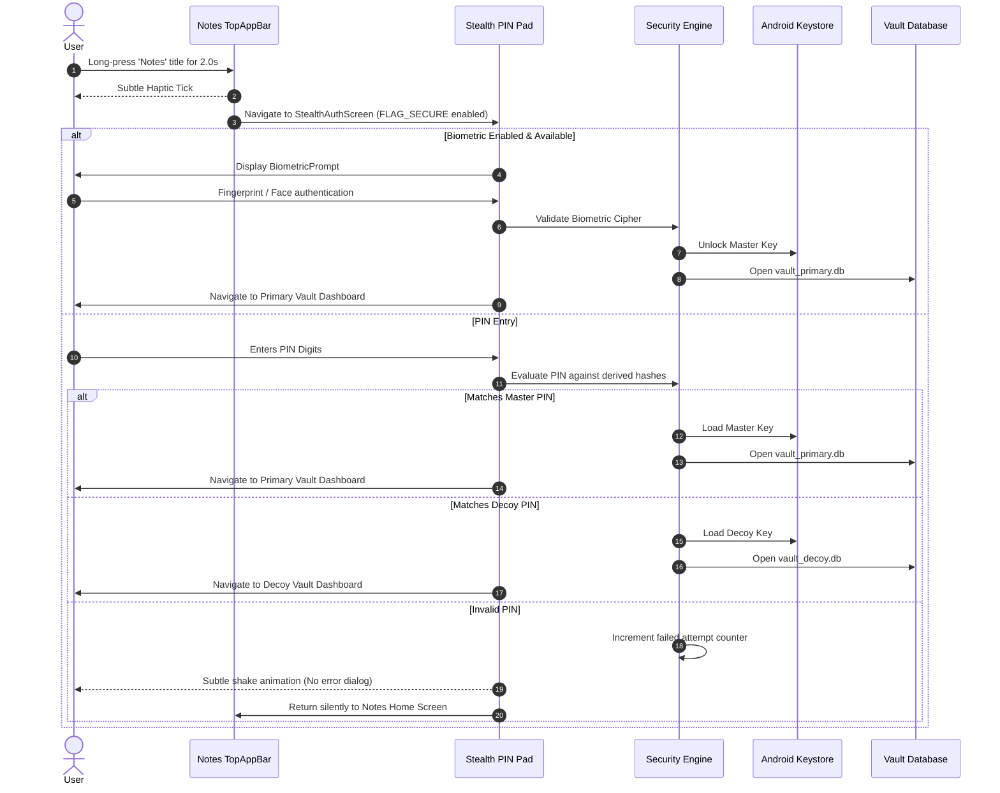
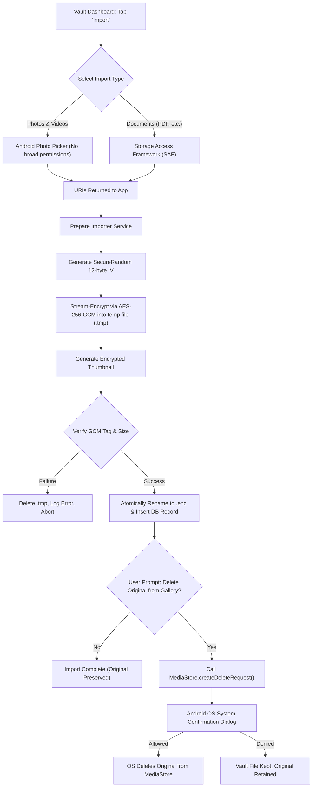
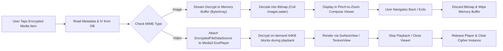
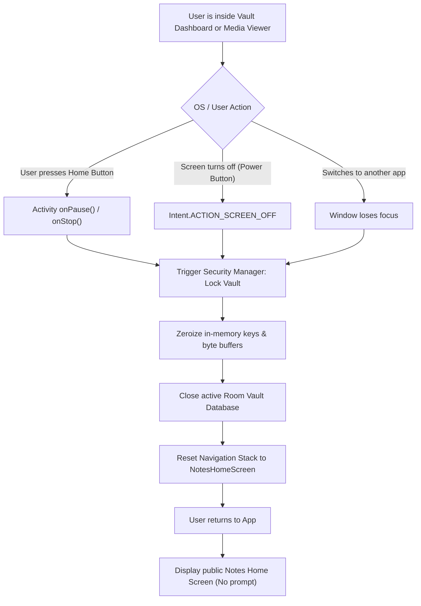

# User Flows & System Journeys — Vault

This document details the primary user journeys, decision branches, system actions, and screen transitions across both the public Notes application and the hidden Vault subsystem.

---

## 1. Flow Overview & Architecture Boundary

---

## 2. User Journey 1: Normal Notes Everyday Usage

### 2.1 Context & Objective
The user or an observer opens the application as an ordinary note-taking tool. The application behaves with zero lag and zero indication of encryption or vault features.

### 2.2 Step-by-Step Flow
1. **Launch:** User taps the app icon labeled **"Notes"** on the home screen.
2. **Display:** Cold starts directly into `NotesHomeScreen` displaying existing notes in a staggered grid or list.
3. **Search / Filter:** User types keywords into the top search bar or selects a category chip (e.g. "Work", "Personal"). The list filters with 300ms debounce.
4. **Create Note:** User taps the floating action button (`+ Note`).
5. **Edit:** `NoteDetailScreen` opens. User enters title, body text, assigns a pastel category color, and toggles pin status.
6. **Save:** Changes auto-save on debounce and immediately write to `notes.db` on back-press or exit.
7. **Observer Experience:** No PIN prompts, no hidden icons, no network logs. The app is 100% functionally complete as a notes app.

---

## 3. User Journey 2: First-Time Vault Initialization

### 3.1 Context & Objective
A new user initializes the hidden Vault for the first time by activating the secret trigger.

### 3.2 Step-by-Step Flow
1. **Trigger:** On `NotesHomeScreen`, the user presses and holds the app title **"Notes"** in the top app bar for 2.0 seconds.
2. **Haptic Acknowledgment:** At 2000ms, the device vibrates with a subtle 25ms tick.
3. **First-Run Auth Screen:** The screen transitions to a neutral setup screen: *"Set Access Code"*.
4. **Master PIN Entry:** User inputs a 4 to 8 digit Master PIN (e.g., `8492`).
5. **Confirmation:** User re-enters the Master PIN.
6. **Key Derivation & Storage:**
   - App generates a 32-byte cryptographically secure salt.
   - Derives Master Verification Hash via PBKDF2WithHmacSHA256 (100,000 iterations).
   - Generates `MasterVaultKey` in Android Keystore with StrongBox/TEE protection.
   - Creates primary vault database: `vault_primary.db`.
7. **Optional Decoy Setup:** App displays an optional setup step: *"Set Alternative Decoy Code"*. The user can set a secondary PIN or choose *"Skip for now"*.
8. **Optional Biometric Setup:** If the hardware supports biometric authentication, the app prompts: *"Enable Biometrics for fast unlock?"*.
9. **Transition:** Navigates directly into the empty `PrimaryVaultDashboard`.

---

## 4. User Journey 3: Secret Vault Access & Stealth Authentication

### 4.1 Step-by-Step Flow Details
1. **Trigger:** User long-presses "Notes" on the TopAppBar.
2. **Flag Secure Activation:** The window flag `FLAG_SECURE` is applied immediately to prevent recents preview and screen recording.
3. **PIN Presentation:** Minimalist keypad is displayed. If biometrics are enabled, the system `BiometricPrompt` displays automatically.
4. **Branch A (Master Match):** App loads `vault_primary/`, unlocks `vault_primary.db`, and opens the user's primary private vault.
5. **Branch B (Decoy Match):** App loads `vault_decoy/`, unlocks `vault_decoy.db`, and opens the decoy vault. The primary vault is completely unreferenced.
6. **Branch C (Invalid PIN):**
   - No dialogue stating "Wrong PIN".
   - The keypad shakes subtly.
   - Digits clear automatically.
   - After 3 incorrect tries, app returns silently to `NotesHomeScreen` as if an ordinary action was cancelled.

---

## 5. User Journey 4: Media Import & Safe Original Deletion

### 5.1 Step-by-Step Flow Details
1. **Initiate:** From `VaultDashboard`, user taps the FAB (`+ Import`).
2. **Picker Interaction:**
   - Photos & Videos: Android System Photo Picker appears (`PickMultipleVisualMedia`).
   - Documents: System Document Browser appears (`OpenMultipleDocuments`).
3. **Processing (Atomic AES-256-GCM):**
   - For each selected URI, an input stream is opened.
   - A unique 12-byte IV is generated.
   - The file is encrypted in 64 KB blocks into `context.filesDir/vault_primary/media/<UUID>.tmp`.
   - A low-resolution thumbnail is generated and encrypted into a small thumbnail blob or file.
   - File length and GCM authentication tag are verified.
   - The `.tmp` file is atomically renamed to `<UUID>.enc`.
   - Metadata (name, mime type, size, album ID, encrypted thumbnail) is written to `vault_primary.db`.
4. **Original File Deletion Flow:**
   - The app asks the user: *"Do you want to remove the imported original files from your device gallery?"*.
   - If user confirms:
     - Android 11+: The app calls `MediaStore.createDeleteRequest(contentResolver, uris)`.
     - Android presents the official system security prompt.
     - Upon user consent, the OS deletes the original from public storage.
   - If user declines: App notifies that the original remains in public storage.

---

## 6. User Journey 5: Secure In-App Media Viewing & Streaming

### 6.1 Critical Privacy Guarantees
- At no point during viewing or playing is an unencrypted file saved to the filesystem or cache folder.
- When the viewer screen is closed, all allocated memory buffers are zeroed out and garbage collected.
- `FLAG_SECURE` prevents capturing screenshots or recordings of the viewer.

---

## 7. User Journey 6: Decoy Vault (Coercion Resistance)

### 7.1 Context & Objective
Under social duress or forced inspection, the user is compelled to open their vault. The user enters their **Decoy PIN**.

### 7.2 Step-by-Step Flow
1. **Trigger:** User long-presses "Notes" title as usual.
2. **Entry:** User enters the **Decoy PIN** (e.g. `1234`).
3. **Decoy Activation:**
   - Security layer matches the Decoy verification hash.
   - Opens `vault_decoy.db` using `DecoyVaultKey`.
   - Mounts the `vault_decoy/` storage folder.
4. **Display:** The UI opens the **Decoy Vault Dashboard**, showing:
   - A few benign photos or documents previously seeded by the user (e.g., recipe snapshots, travel tickets).
   - Normal album structure.
5. **Security Isolation:**
   - The primary database (`vault_primary.db`) is NEVER touched or opened.
   - Master Keystore alias is NEVER accessed.
   - Storage statistics in Decoy Settings only show Decoy file usage.
   - There are no visual or programmatic clues that another vault exists on the device.

---

## 8. User Journey 7: Auto-Lock & Backgrounding Lifecycle

---

## 9. User Journey 8: Encrypted Backup & Recovery

### 9.1 Backup Export Flow
1. User enters Primary Vault -> Settings -> **"Backup & Restore"**.
2. User taps **"Create Encrypted Backup"**.
3. User enters a strong **Backup Passphrase** (minimum 8 characters) and confirms it.
4. App generates 32-byte salt and derives a 256-bit AES-GCM key using PBKDF2/Argon2.
5. App packages encrypted media items and exported database records into a single `.vlt` archive.
6. The archive is encrypted with AES-256-GCM with a verified authentication tag.
7. User selects save destination via SAF (`CreateDocument`).

### 9.2 Restore Flow
1. In a fresh or existing installation, user navigates to Vault Settings -> **"Restore Backup"**.
2. User picks the `.vlt` file using SAF.
3. User enters the **Backup Passphrase**.
4. App reads header, salt, and IV; derives candidate key.
5. App verifies the archive authentication tag.
   - If incorrect: *"Invalid passphrase or corrupted backup file"*.
   - If verified: Extracts files into `vault_primary/` and merges/reconstructs database entries.
6. Display restore summary: *"Successfully restored X files and Y albums"*.

